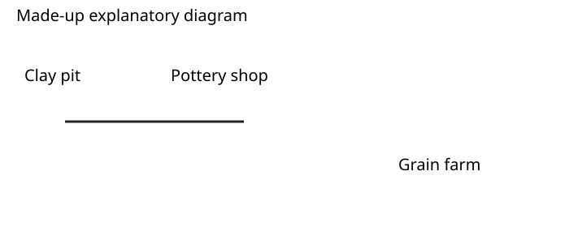

# Day 130 held source record

These records are made up.

A map locates a clay pit and pottery shop apart from a grain farm.
Caption: This town sends pots away and receives grain.
False claim: Everyone has one job. Our region makes everything it needs.

