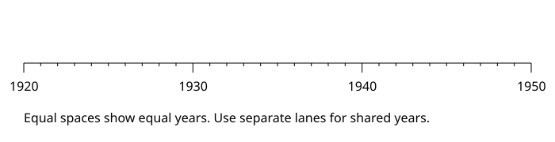

# Fresh component retry

Name: __________________

Use only your assigned fresh task. These cases are made up.

## Dates

Records: 1920, 1940, 1950.

Place the records. Label the earliest-to-latest span.

________________________________________________

## Public work

A national judge decides a case. A governor leads a state.
A town record dates a bridge repair.

Match the national worker to a building and branch.

________________________________________________

## New map fragment

Brook Basin: pond (1,2); road from (0,0) to (3,0); bridge (2,0).
Each square side represents one kilometer. North is up.

Map the features using a consistent key.

________________________________________________

## Exchange and evidence

Orchard worker's note: I sell packing work and buy fruit.
Packing business's note: We sell packed fruit and buy boxes.
Independent freight note: Packed fruit left this morning.

Explain both actors' exchanges using the freight note.

________________________________________________
