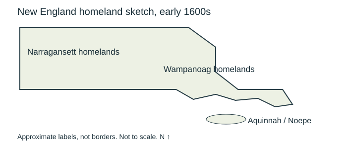

# Sources and work, day 1

## Homeland and claim

Wampanoag communities already lived and governed here.
Aquinnah history describes homelands in southeastern Massachusetts and eastern Rhode Island.
The English king's 1663 charter claimed land for Rhode Island colonists.
A royal claim does not itself establish everyone's agreement.
Makers: Aquinnah, modern public history; Charles II, charter, 1663.
Sources: s01-01-homeland; s01-01-charter. Original summaries.

Colony: a settlement far from the home country, which claims it.
Historical charter: an official grant, a different sense from our class-agreement charter.
Ownership: rights claimed over land.

## Individual work

How does a voyage differ from a colony?

________________________________________________

________________________________________________

Name a Native nation already living where settlers arrived.

________________________________________________

________________________________________________

An invented history written in 2020 describes an agreement in 1621. Label event and account dates.

________________________________________________

________________________________________________

Sort topic cards by the day their evidence will help investigate.

________________________________________________

________________________________________________
