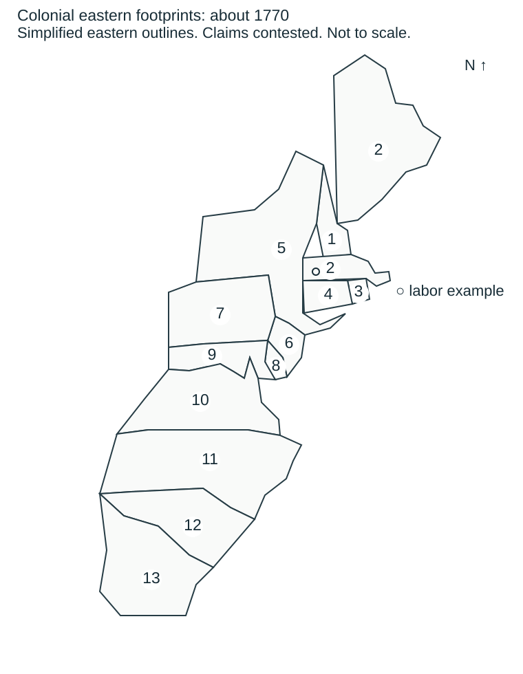

# Assessment source sheet, day 13

## Sources

1. Aquinnah, modern history: disease devastated villages; communal practices conflicted with English private claims.

2. Easton, 1675: leaders disputed English documents claiming extra land before war.

3. Federal history: Massachusetts Bay enforced conformity; Rhode Island's 1663 charter protected peaceful dissent.

4. English charters: Rhode Island elected deputies; Massachusetts Bay laws must follow England's.

6. Penn, 1682: worship protection required acknowledging God; voting and office required Christian faith.

Summaries; Easton mediates leaders' complaints.

## Card 5: atlas, about 1770

| Name bank |
|---|
| New Hampshire |
| Massachusetts |
| Rhode Island |
| Connecticut |
| New York |
| New Jersey |
| Pennsylvania |
| Delaware |
| Maryland |
| Virginia |
| North Carolina |
| South Carolina |
| Georgia |

New England: short summers/oats; Middle: longer seasons/wheat; Southern: long warmth/tobacco.
Tobacco must mature before frost.

Labor words: family; wage; bound term; enslaved.
Meanings: A, limited service term; B, relatives' work; C, forced under slavery; D, paid employment.
Open circle: enslaved labor. Symbols show presence.

