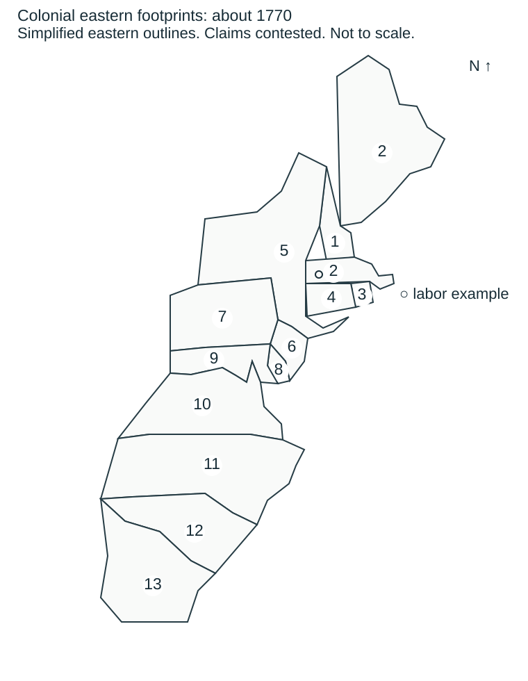

# End-of-unit assessment

Name: ____________________

Our question: Whose land was it, and who decided?

## Sources

1. Aquinnah history, modern: disease devastated villages; communal practices conflicted with English private claims.

2. Easton, 1675: leaders complained English documents claimed more land than agreed. War followed.

3. Federal history: Massachusetts Bay enforced religious conformity. Rhode Island's 1663 charter protected peaceful religious disagreement.

4. English charters: Rhode Island elected assembly deputies; Massachusetts Bay laws must agree with England's laws.

6. Penn, laws XXXIV/XXXV, 1682: worship protection required acknowledging God; voting and office required Christian faith.

These are summaries, not quotations. Easton mediated leaders' complaints.

## Card 5: atlas, about 1770

Name bank: New Hampshire; Massachusetts; Rhode Island; Connecticut; New York; New Jersey; Pennsylvania; Delaware; Maryland; Virginia; North Carolina; South Carolina; Georgia.

New England: short summers, oats. Middle: longer seasons, wheat. Southern: long warmth, tobacco.
Tobacco needs maturity before frost.

Labor words: family; wage; bound term; enslaved.
Meanings: A, limited service term; B, relatives' work; C, forced under slavery; D, paid employment.
Open circle: enslaved labor. Symbols show examples, not amounts.

## Responses

### s01-Q1a

Use card 1. Explain one effect of disease.

________________________________________________

### s01-Q1b

Use card 1. Explain the land-practice difference.

________________________________________________

### s01-Q1c

Use card 2. Explain one dispute linked to King Philip's War.

________________________________________________

### s01-Q2a

Use card 3. Compare the two colonies' religious aims.

________________________________________________

### s01-Q2b

Check your retained Penn finding against card 6. Cite your research source.

________________________________________________

________________________________________________

________________________________________________

### s01-Q3

Use card 4. Explain continuing English influence despite other nations' exploration.

________________________________________________

### s01-Q4a

Label card 5's thirteen numbered footprints.

________________________________________________

### s01-Q4b

Use card 5. Explain climate's effect on one crop in each region.

________________________________________________

### s01-Q4c

Match the four labor words to card 5's meanings.

________________________________________________

### s01-Q4d

Circle one northern enslavement symbol on card 5.

________________________________________________

### s01-Q5

Underline one detail per card, 1 and 2, answering our land question.

________________________________________________

### s01-Q6

Answer our land question in a paragraph. Connect your claim to evidence from both named cards.

________________________________________________

________________________________________________

________________________________________________

### s01-Q7

Made-up town: a riverside path may close. A gardener delivers there; a walker reaches the park. Explain why the decision matters to each.

________________________________________________
