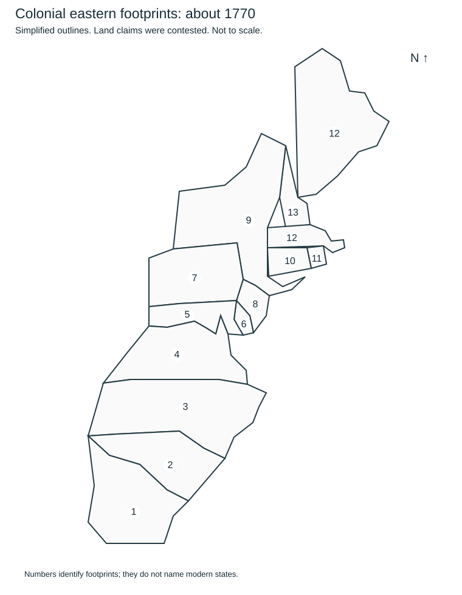

---
day: 10
course: social-studies-grade-5
unit: 1.4
version: draft 1, not ready, not yet taught
exit: half
materials: Per child: pencils and paper; timeline and source log; sources-10 sheet; colonial atlas reference; held exit map and inset. Per class: unit record sheet and family note; section 1.4 exit tickets and teacher keys. Use the printed student frame for source notes and practice; the named sources sheet supplies the summaries. Hand-copy if printing fails.
print: One two-sided student page per child, with the held map on Side 2; one X10b half-slip. Use exit-box-10.md as the response-table master, covered until the exit. Keep teacher keys separate.
credit: ours
leans_on: docs/courses/social-studies-grade-5/s01.md; docs/courses/social-studies-grade-5/u01-4.md; courses/social-studies-grade-5/u01-4/opener.md; courses/social-studies-grade-5/u01-1/record.md; courses/social-studies-grade-5/u01-1/family.md; courses/social-studies-grade-5/u01-1/timeline.md; courses/social-studies-grade-5/u01-1/source-log.md; courses/social-studies-grade-5/u01-4/sources-10.md; courses/social-studies-grade-5/u01-4/atlas-reference.svg; courses/social-studies-grade-5/u01-4/map-exit-10.svg; courses/social-studies-grade-5/u01-4/exit-box-10.md; courses/social-studies-grade-5/u01-4/exits.md; courses/social-studies-grade-5/u01-4/key-exits.md; courses/social-studies-grade-5/u01-4/key-maps.md
---
# Day 10: Regions and growing conditions

## Teacher page

### Before class

Separate key-exits.md, key-maps.md and generated keys. Cover Side 2 and the half-slip. Use sources-10.md for the regional summaries below, printed once. Enlarge the atlas to read labels. Keep historical outlines unmeasured. Prepare three equal paper bars for the invented route. Sort day 9's papers by one priority.

### The day

#### 3 min. Map retrieval

Yesterday's continuing institutions lead to locating colonies. Review legend: the map key. Review scale: one map length represents a ground distance. All complete [[s01-T10a]] and [[s01-T10b]] in their source logs. Show three equal bars, each representing 25 miles. Teacher only: [[steps:s01-T10b]]. Note needs without a public round.

#### 10 min. Return and repair

Return day 9's whole batch, including sequence annotations. Choose one priority: error E uses arrival alone; error L ranks peoples; error H selects irrelevant support. Explain for five minutes, then [[s01-R10-1]] for five. For a priority map gap, instead repeat the key/bar demonstration and let children correct their log. Give other needs written cues. More than ten misses makes one whole-class priority.

#### 10 min. Explain regions

Review region: a group of states that sit together and share something. Extend the grouping to colonies. Review climate: what a place is usually like over many years. Read the regional notes. Point through all thirteen atlas labels, keeping Massachusetts and its Maine area together. The date matters; current state outlines differ. These outlines show colonial claims, not Native consent.

Explain one Southern fragment: tobacco needs time to mature before frost. Planting and harvest decisions matter alongside soil and climate. Climate never forced people to enslave others. Oats and wheat are other regional examples, not exclusive crops. Do not write a complete three-region explanation.

#### 5 min. Atlas pointing

Fifteen pairs point to labeled places, one 45-second turn each. Each annotates [[s01-P10]] and answers [[s01-T10c]] in the log. Use separate fragments, without blank-map labeling. Collect all logs with the exit batch.

#### 12 min. Exit ticket

First reveal Side 2 and [[s01-X10a]], then the half-slip [[s01-X10b]]. Allow two minutes reading, five labeling, four linking conditions, one collecting. Write numbered names in the log's Exit box; provide the master table if needed. Keep the atlas covered. Read neutrally or transcribe exact dictation. No child marks a key.

After class, allow thirty times 60 seconds for maps and climate, thirty minutes; logs need ten more. Record shown, shown with help, or not yet seen per component. Record support separately; blank work diagnoses no error.

### Other rooms

Hand-copy source summaries and numbered outlines before class. Preserve the map's readable labels; measure only the invented bars.

### At home

**Swap.** No printer: copy notes, numbered outlines and response table. No strips: fold paper equally.

**Skip.** Public talk and the class return.

- **5 min. Retrieve.** Use [[s01-T10a]] and [[s01-T10b]] in the log.
  **Say.** "How far do three bars represent?" Expect: 75 miles.
- **10 min. Read.** Read regional notes and point through the labeled atlas together.
- **8 min. Annotate.** Take the partner turn for [[s01-P10]].
  **Say.** "Which season detail did you mark?" Expect: a detail printed beside that region.
- **12 min. Exit ticket.** First reveal [[s01-X10a]] and [[s01-X10b]]. Cover the reference atlas. Your child answers alone. Collect before discussing.

### Shorter or longer

Shorter: reduce paired pointing. Keep regional explanation and both exit items. Longer: reread a source's geographic limits.

### Words and supports

Use the review definitions above. Offer movable colony labels, enlarged maps, neutral reading or dictation. Do not mark handwriting.

### Tomorrow

Day 11 returns day 10's entire batch in Return and repair. Choose location errors F/N or climate errors O/J for one explanation and fresh response. Then distinguish family, hired, indentured and enslaved labor.

### Credit

Ours. Regional reference, historical map and federal cultivation history support the original summaries.

## Student page

### Side 1

**We can locate colonies and connect growing conditions to crops.**

**Sources-10 sheet: regional notes, about 1770.**

New England: short summers; small farms grew oats among other crops.
Middle: longer growing seasons and suitable soil supported wheat.
Southern: long warmth supported tobacco; frost could destroy a late crop.
Soil and human choices also mattered.
These examples do not describe every crop or job.
Sources: regional geography reference; historical atlas; federal tobacco history.
Modern public histories explain colonial conditions to readers.

Review: legend means the map key.
Review: climate means what a place is usually like over many years.

**Map retrieval.**

1. [[s01-T10a]]
2. [[s01-T10b]]

Write in your source log.

**Return.**

3. [[s01-R10-1]]

**Atlas notes.**

4. [[s01-P10]]
5. [[s01-T10c]]

Keep each note separate in your log.

**Exit box, keep covered.**

6. [[s01-X10a]]

Name bank: New Hampshire; Massachusetts; Rhode Island; Connecticut; New York; New Jersey; Pennsylvania.
Delaware; Maryland; Virginia; North Carolina; South Carolina; Georgia.
Write numbered answers in your log's Exit box.

### Side 2

