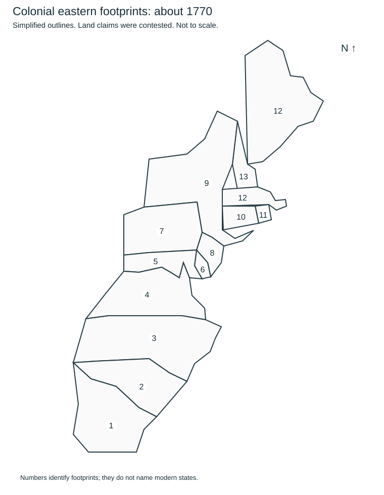

# Student page: day 10 Exit box

Name: ____________________

Use the dated exit map and name bank. Label all thirteen numbered colony footprints.

## Name bank and response table

| Name bank |
|---|
| New Hampshire |
| Massachusetts |
| Rhode Island |
| Connecticut |
| New York |
| New Jersey |
| Pennsylvania |
| Delaware |
| Maryland |
| Virginia |
| North Carolina |
| South Carolina |
| Georgia |

Write each name beside its map number.

| Number | Colony | Number | Colony |
|---|---|---|---|
| 1 | __________________ | 8 | __________________ |
| 2 | __________________ | 9 | __________________ |
| 3 | __________________ | 10 | __________________ |
| 4 | __________________ | 11 | __________________ |
| 5 | __________________ | 12 | __________________ |
| 6 | __________________ | 13 | __________________ |
| 7 | __________________ |  | __________________ |
