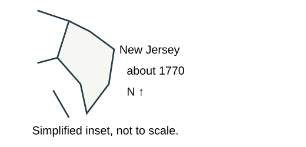

# Reserved exit tickets

Teacher: cut by day. Hide tickets until their exit part.

## Day 10

Name: ____________________

The location response is on exit-box-10.md, collected with this half-slip.

### s01-X10b

Use the growing-condition notes. Explain how climate helped one crop grow in each region.

________________________________________________

________________________________________________

### Growing conditions

New England: short summers; oats on small farms.

Middle: longer growing seasons; wheat.

Southern: long warmth; tobacco needs maturity before frost.

Soil and human choices also matter.

## Day 11

Name: ____________________

### s01-X11a

Made-up colonial records: New England relatives farm together. A Middle craftsperson earns wages. A Southern servant owes a bound term. A New England household enslaves someone. Name the four labor arrangements.

________________________________________________

________________________________________________

### s01-X11b

Use the last made-up New England record. Explain what it shows about where slavery existed.

________________________________________________

________________________________________________

## Day 12

Name: ____________________

### s01-X12

The dated inset marks New Jersey. This example shows wheat and enslaved people forced to work. Add this colony's crop and labor symbols to the empty key.

Crop symbol: ____ Label: __________________

Labor symbol: ___ Label: __________________

________________________________________________

________________________________________________

