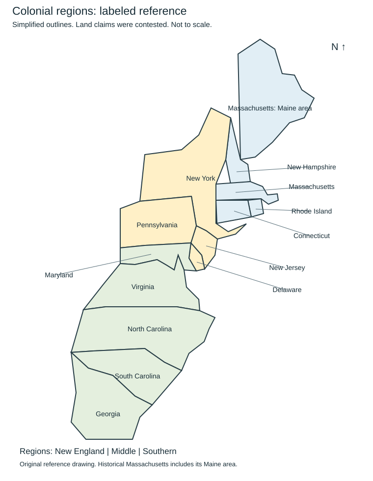

# Map display

Trace regional bands on a separate copy.
Read this prepared key; do not construct an empty key.

Triangle: crop example. Open circle: labor example.
Keep crop notes and people in separate bands.

Crop source note: ______________________________________

Labor source note: _____________________________________

Map date and source: ___________________________________

One limit of the symbols: _______________________________
