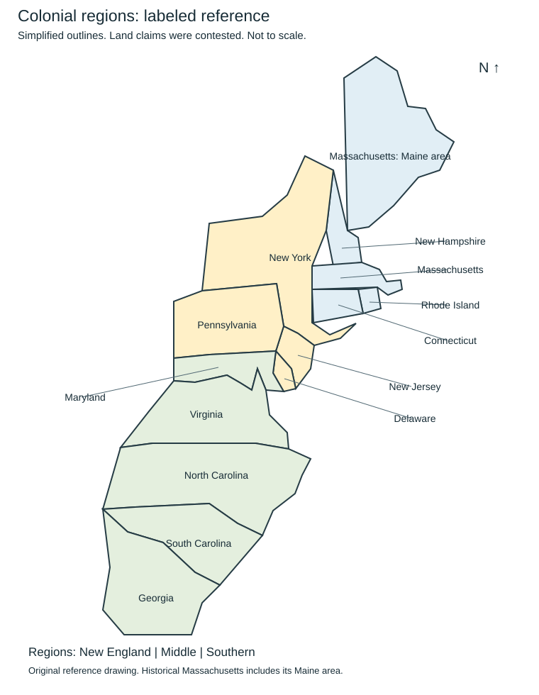

# Sources and work, day 10

## Regional notes, about 1770

New England: short summers; small farms grew oats among other crops.
Middle: longer growing seasons and suitable soil supported wheat.
Southern: long warmth supported tobacco; frost could destroy a late crop.
Soil, planting decisions and other choices also mattered.
These examples do not describe every crop or job.
Climate: what a place is usually like over many years.
Region: places grouped because they sit together and share something.
Legend: the map key.
Sources: s01-10-regions; s01-10-atlas; s01-10-tobacco. Original summaries.
Use the separate invented route for scale practice.

## Individual work

Invented map: dots mean corn; squares mean wheat. Explain a footprint containing both.

________________________________________________

________________________________________________

An invented route measures three 25-mile bars. Find its distance.

________________________________________________

________________________________________________

How might a river help crops reach buyers?

________________________________________________

________________________________________________

Annotate one growing-season detail.

________________________________________________

________________________________________________
