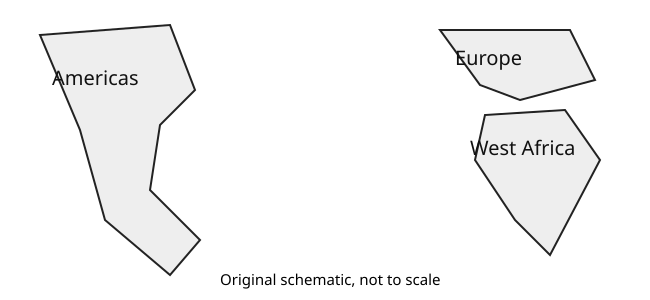

# Day 17: Read a network, then construct one

## Teacher page

### Before class

Use unit 2 completed network as a teaching display; retain unit 2 law slips. Print student pages and unit 2 private exit 17 half slips. Copy only R17 from unit 2 section 1 fresh checks. Keep Side 2 and slips sealed until the exit. Read teacher-only key-u2.md and generated keys. Lay out paper strips matching one drawn scale bar.

### The day

#### 10 min. Return and repair

Return all day 16 paper. If many tickets showed error A, spend five minutes placing Virginia's arrival after earlier Atlantic transport. For error I, annotate the maternal clause separately. Choose one priority; retain others. Use unseen [[s02-R17]] during five minutes of fresh individual paper. Collect; record its narrow result without claiming every gap repaired.

#### 10 min. Explain network

Review the simplified network introduced on day 16. Interpret completed links, keeping people separate from goods. Europe to Africa carries manufactured goods; Africa to the Americas forcibly transports enslaved Africans; plantation goods travel toward Europe. Teach Middle Passage: forced Atlantic crossing from Africa to the Americas. People are never goods or willing migrants in this crossing.

Ships followed varied routes. A diagram of connections cannot establish every vessel's journey. **Ask.** [[s02-P17-1]] Expect: Africa to the Americas. Ask before pointing. Do not construct arrows with the class.

#### 10 min. Read and annotate

Read the neutral conditions summary aloud. Crews confined people with too little space, air and water; many became ill or died. Keep details non-graphic. Children match vocabulary in [[s02-P17-2]], without practicing a causal paragraph.

Review scale: paper strip laid end to end on a scale bar, counted in whole bars. Show the separate made-up segment from network-17.md; use [[s02-P17-3]]. It measures a model, never a voyage. Pairs take 45 seconds each way. Within five minutes hear at most six optional 45-second observations; record names and collect everyone's notes.

#### 10 min. Exit ticket

First give sealed Side 2, map X17 and [[s02-X17a]]. Children draw independently for five minutes. Reveal half slip [[s02-X17b]] for four minutes, neutral reading included; collect both in one minute. Remove teaching diagrams first. After class, thirty times 60 seconds gives thirty minutes to mark all responses. Use shown, shown with help, not yet seen; support separately. Return everything on day 18.

### Other rooms

No projector: point to teacher-held teaching panels. No printer: hand-copy the student text and separate held checks, preserving covered exit work. Dictated responses are transcribed onto paper.

### At home

**Swap.** No printer: copy the completed teaching links, scale model and separate blank exit outline. Keep the outline covered.

**Skip.** Public observations.

- **10 min. Return.** Explain one need from yesterday. Give [[s02-R17]] alone afterward.
- **10 min. Network.** Read the completed links. Use [[s02-P17-1]].
  **Say.** "Which link shows forced crossing?" Expect: Africa to the Americas.
- **10 min. Annotate.** Use [[s02-P17-2]] and [[s02-P17-3]]. Place the strip end to end.
  **Say.** "How many whole bars fit?" Expect: three.
- **10 min. Exit ticket.** Hide teaching diagrams. Reveal Side 2 and [[s02-X17a]], then [[s02-X17b]]. Your child answers alone. Collect before discussing.

### Shorter or longer

Shorter: reduce public sharing, preserving individual work, repair and exit time. Longer: name one detail the source cannot establish, without previewing another case.

### Words and supports

Captive: a person held against their will. Review scale and forced labor in earlier words. Offer tactile outlines or neutral dictation onto paper. A pause never requires a personal explanation. No bodily demonstration of confinement.

### Tomorrow

Day 18 returns all day 17 paper. If many show error B, distinguish forced people from objects and choice. For error J, interpret one documented link without assuming a complete voyage. Use one explanation and fresh R18 in Return and repair. Then study slavery's legal reach and ownership evidence.

### Credit

Ours. Sources s02-passage, s02-routes and s02-network support route and conditions summaries. The separate distance model is made up.

## Student page

### Side 1

**We can explain Atlantic routes and forced crossings.**

1. [[s02-R17]] {small}

**Completed teaching links, not to scale.**

Goods: Europe → Africa, manufactured goods.
People forced: Africa → Americas, the Middle Passage.
Goods: Americas → Europe, plantation goods.
Actual voyages varied.

2. [[s02-P17-1]] {small}

**Conditions summary.**

Crews confined people with little space, fresh air or water.
Many people became ill or died.

3. [[s02-P17-2]] {small}

Crowded: little space. Confined: held within. Ventilation: fresh air moving through.

**Separate made-up distance model.**

One bar: |________| = 10 distance units.
Segment: |________|________|________|

4. [[s02-P17-3]] {small}

### Side 2

**Exit box. Open only during the exit.**

Map X17, not to scale.

5. [[s02-X17a]] {work}
