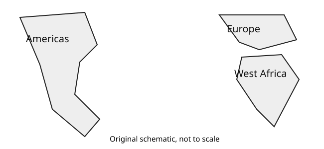

# Private exit work, day 17
Name: __________________

Map X17: original outline without routes.

## Exit box, student page
[[s02-X17a]]

________________________________________________

________________________________________________

## Exit ticket, half slip
[[s02-X17b]]

________________________________________________

________________________________________________
