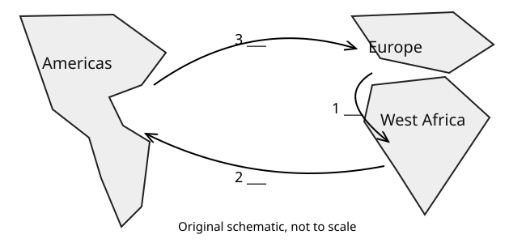

# End-of-unit assessment, day 25
Name: __________________
How did enslaved and free Africans shape the colonies? How did they seek freedom?
Use the separate source sheet and teacher-read context.

## Side 1, Q1 to Q3
Map M3 is not to scale. Real voyages varied.

[[s02-Q1a]]

________________________________________________

[[s02-Q1b]]

________________________________________________

[[s02-Q1c]]

________________________________________________

[[s02-Q1d]]

________________________________________________

[[s02-Q2a]]

Write on the map.

[[s02-Q2b]]

________________________________________________

[[s02-Q3a]]

________________________________________________

[[s02-Q3b]]

________________________________________________

## Side 2, Q4 to Q9

[[s02-Q4a]]

Mark the source sheet.

[[s02-Q4b]]

________________________________________________

[[s02-Q5]]

________________________________________________

[[s02-Q6a]]

________________________________________________

[[s02-Q6b]]

________________________________________________

[[s02-Q7a]]

________________________________________________

[[s02-Q7b]]

________________________________________________

[[s02-Q8a]]

Mark the source sheet.

[[s02-Q8b]]

________________________________________________

________________________________________________

________________________________________________

________________________________________________

[[s02-Q9]]

________________________________________________

