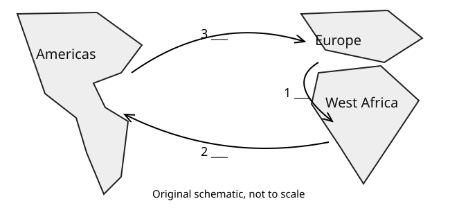

# Day 25: Use new records independently

## Teacher page

### Before class

Print unit 2 assessment packet from today's two sides only, including map and source summaries. Shared assessment masters are teacher references. Read context-25.md and teacher-only ../u02-1/key-u2.md. Hide unit 2 timeline and source prompts; seal day 24 feedback.

### The day

#### 1 min. Directions

Students work alone. Offer neutral reading, a pause or transcribed dictation. M4 is made up.

#### 5 min. Read context

Read A/B neutrally with maker, date and audience. Read remaining context-25.md panels within their question allocations. Supply no law effects or reasoning.

#### 30 min. End-of-unit assessment

Q1: four minutes; Q2: four; Q3: four; Q4: three; Q5: two; Q6: three; Q7: three; Q8: six; Q9: one. No partner help or self-marking. Q8a/b share one argument; judge components separately.

#### 4 min. Collect and close

Collect before restoring displays. Mark afterward: 30 times three minutes, ninety minutes. Use shown, shown with help, not yet seen on the unit 2 record; access separately. Return on day 26.

### Other rooms

Without printing, copy both sides, including the map, before class. Transcribe dictation neutrally onto paper.

### At home

**Swap.** No printer: copy both sides, including sources and map.

**Skip.** Class distribution and public closing.

- **5 min. Directions.** Put teaching notes away. Your child works independently.
- **5 min. Sources.** Read A and B neutrally. Keep both visible.
- **30 min. Assessment.** Use both student sides. Read each context panel within its matching question's time. Reread without hints; write dictated answers exactly.
- **5 min. Collect.** Put sheets away. Read the private key afterward. Tomorrow explain one need and try one fresh case.

### Shorter or longer

Keep every item. Allow neutral rereading or pauses, recording support.

### Words and supports

Use taught words without new examples. Keep source identities visible.

### Tomorrow

Day 26 returns day 25's assessment and day 24's work privately. Route A/I to law, B/J to routes, C/K/S to records, D/E/L to family/action, F/M/Q to work, G/N to procedures, O/P to change, H to links and R to audience. Repair one priority; retain others.

### Credit

Ours. Source credits and URLs accompany the source sheet and teacher panels.

## Student page

### Side 1

**We can use new records to show our understanding.**

**Original source summaries.**

**A. Alexander Falconbridge, surgeon, published account, 1788.**
People were confined below deck, in heat without fresh air.
Many became sick and died.

**B. Felix, January 1773 petition to Massachusetts provincial government.**
Petitioners described children under others' control and insecure property rights.
They asked government for relief from slavery.

**Q1.**

1. [[s02-Q1a]]

________________________________________________

2. [[s02-Q1b]] __________________

3. [[s02-Q1c]]

________________________________________________

4. [[s02-Q1d]] __________________

**Q2.**

5. [[s02-Q2a]]

6. [[s02-Q2b]]

________________________________________________

**Q3.**

7. [[s02-Q3a]]

________________________________________________

________________________________________________

8. [[s02-Q3b]]

________________________________________________

### Side 2

**M4. Made-up record.**
Mara is an enslaved Black adult. Her enslaver sells her away from her family.
He blocks her reading lessons. He beats her and threatens punishment for escape.
Mara makes wooden bowls.

**Q4.**

9. [[s02-Q4a]]

10. [[s02-Q4b]]

________________________________________________

**Q5.**

11. [[s02-Q5]]

________________________________________________

**Q6.**

12. [[s02-Q6a]]

________________________________________________

13. [[s02-Q6b]]

________________________________________________

**Q7.**

14. [[s02-Q7a]]

________________________________________________

15. [[s02-Q7b]] ________________________________

**Q8.**

How did enslaved and free Africans shape the colonies?
How did they seek freedom?

16. [[s02-Q8a]]

17. [[s02-Q8b]]

________________________________________________

________________________________________________

________________________________________________

________________________________________________

**Q9.**

18. [[s02-Q9]]

________________________________________________
