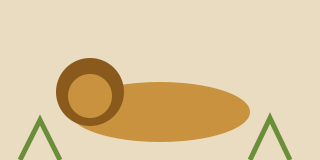

A lion lay asleep in the warm grass. A little mouse ran across his paw and woke him up.

The lion trapped the mouse under one huge paw. "You will make a fine snack," he said.

"Please let me go," cried the mouse. "Someday I may be able to help you."

The lion laughed. How could a tiny mouse ever help the {king of beasts|the strongest animal of all, the one the others obey}? But he lifted his paw and let the mouse go.

---

## The net

A few days later, hunters set a trap in the forest. The lion stepped into it, and a heavy net fell over him. He roared and pulled, but the ropes only grew tighter.

The mouse heard the roar. She ran to the lion and began to {gnaw|bite again and again with small sharp teeth} the ropes. One rope snapped, then another, until the lion was free.

"You laughed at me," said the mouse. "Now you know that even a little mouse can help a lion."

**Little friends may prove great friends.**
