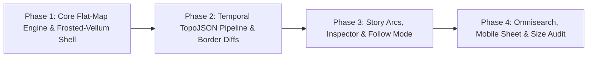

# Reimagined Historical Atlas — Flat-Map, Story-First Blueprint (`< 2 MB`)

A focused plan to reimagine [chroniaatlas.com](https://www.chroniaatlas.com/) into a **flat-map, story-driven historical border atlas** with an authentic archival paper-and-ink aesthetic, frosted-vellum UI, and a strict **under-2 MB total footprint**.

---

## 1. Core Product Pivot (Compared to Chronia)

| Dimension | Original Chronia | Our Reimagination |
| :--- | :--- | :--- |
| **Projection** | 3D-shaded orthographic globe + secondary flat mode | **Flat Map First (Natural Earth / Equal Earth projection)** — lets you watch simultaneous multi-region empire shifts across Eurasia, Africa, and the Americas without hiding half the world. |
| **Visual Feel** | Beveled brass gradients, heavy drop shadows, "CGI" globe shading | **Fine-Print Archival Cartography + Frosted-Vellum HUD** — tactile rag paper (procedural grain, 0 KB images), soft mineral gouache territory washes, engraved ink borders, and airy frosted-vellum glass panels. |
| **Storytelling** | Encyclopedia blurbs + disconnected `Changes`/`Wars` boxes | **Borders & Stories Intertwined** — clickable border shifts, animated territory-change highlights, and guided multi-stop **Story Arcs** that pan, zoom, and scrub time as you read. |
| **Layout** | Independent floating boxes that overlap on desktop & mobile | **Zero-Overlap Spatial Shell** — slim floating top bar, single docked right frosted-vellum drawer (mobile 3-detent bottom sheet), collapsed-by-default legend pill, and zoomable bottom timeline. |
| **Weight** | Heavy runtime + external API dependencies | **Strictly `< 2 MB` total** — custom lightweight Canvas 2D + SVG renderer, shared-arc quantized TopoJSON, and self-contained curated stories. |

---

## 2. Visual System: Authentic Parchment Without the "CGI" Vibe

To avoid synthetic 3D gloss and look like a museum-grade printed atlas brought to life:
- **Flat, Matte Archival Surface:** Warm rag-paper ground (`#F3EDE0`) with subtle procedural SVG `<feTurbulence>` paper grain (zero raster textures). Oceans rendered in muted antique celadon/slate-parchment (`#DCE3DF`) with delicate coastal tinting rather than shiny gradients.
- **Mineral & Gouache Palette:** Muted earth pigments (terracotta, sage, ochre, indigo-slate, dusty rose, umber) with soft translucent washes (`0.55–0.72` opacity) so subtle terrain/rivers breathe underneath, plus a toggleable color-blind safe palette.
- **Engraved Linework:** Crisp `0.75px–1.25px` dark-sepia ink strokes (`#3D3226`) for settled borders, fine stippled/dashed lines for fluid frontiers and nomadic zones, and subtle diagonal ink hatching for disputed or transitional regions.
- **Frosted-Vellum UI Surfaces:**
  - `background: rgba(250, 246, 238, 0.78)`
  - `backdrop-filter: blur(14px) saturate(1.1)`
  - `border: 1px solid rgba(76, 61, 44, 0.16)`
  - Subtle flat elevation shadows (no embossed bevels, no metallic gradients).
- **Editorial Typography:** Classic engraved serif for map labels and story titles paired with crisp readable body serif and `tabular-nums` sans for dates and timeline ticks.

---

## 3. Signature Experiences: Making Borders & Stories Come Alive

### A. Visual Border-Change Diffs ("See What Moved")
- When stepping forward/backward in time, newly gained, lost, or fractured territories briefly **pulse with a soft ink-wash highlight** on the map.
- Clicking any highlighted shift—or selecting an entry in the **Changes** tab—smoothly glides the camera to that border corridor and opens the story behind *why* the line moved (treaty, conquest, collapse, unification).

### B. Guided Story Arcs (Spatial Historical Narratives)
- A curated **"Stories"** mode featuring multi-chapter visual journeys (e.g., *The Rise & Fracture of Rome*, *The Mongol Storm*, *The 1815 Redrawing of Europe*, *Scramble & Decolonization*, *The Silk Road Corridors*).
- Advancing a chapter smoothly animates the flat map's camera, scrubs the year, spotlights the active empires/frontiers while gently dimming the rest of the world, and presents a concise, engaging story card in the frosted-vellum drawer.

### C. Smooth Multi-Scale Timeline & "Follow Through Time"
- **Zoomable Flat Timeline Rail:** Scroll or pinch on the timeline to zoom smoothly from **Full History → Century → Decade → Year**, backed by a **border-activity sparkline** showing historical inflection points.
- **Collision-Free Event Markers:** Edge-aware staggered milestone ticks with hover previews (never clipped or overlapping).
- **Follow an Empire:** Click any state → `"Follow through time"` smoothly tracks its borders expanding and contracting across its full lifespan, with a compact floating lifespan bar (`1299 ──●──── 1922`) and live territory/story callouts.

### D. Cross-Era Omnisearch (`⌘K`)
- Search across **all eras simultaneously** (empires, cities, treaties, stories, and dates).
- Searching `"Roman"` while viewing `1815` immediately offers *"Roman Empire (27 BC – 476 AD) — Jump to 117 AD peak"* alongside any active-year matches, with clear empty states and inline date validation.

---

## 4. Strict `< 2 MB` Engineering Budget & Architecture

Keeping the entire project under **2 MB uncompressed** (and **< 650 KB gzipped**) makes the app launch almost instantaneously and run at a locked 60fps.

| Component | Strategy | Estimated Size |
| :--- | :--- | :--- |
| **Rendering Engine** | Zero heavy map libraries (no MapLibre/Three.js). Custom **HTML5 Canvas 2D** renderer with Natural Earth/Equal Earth projection math, `requestAnimationFrame` inertia pan/zoom, offscreen coastline cache, and bbox/polygon hit-testing. | **~35 KB** |
| **Historical Map Geometry** | **Shared-Arc Quantized TopoJSON** (`11–12 bit` delta-encoded integers, Visvalingam–Whyatt simplified for world/regional zoom). Coastlines & persistent borders are stored **once** and referenced by arc index across eras, using `[startYear, endYear]` validity intervals instead of duplicating full maps per year. | **~1.1 – 1.3 MB** |
| **Stories, Empires & Events** | Structured JSON containing rich curated stories, multi-stop Story Arcs, empire lifespans, capitals, and key border-change explanations. | **~180 – 250 KB** |
| **UI, Styles & Icons** | Lean vanilla TypeScript/JS (zero framework bloat) + modular CSS frosted-vellum design tokens + inline SVG icons + procedural SVG paper grain. | **~60 – 90 KB** |
| **Total Footprint** | **Complete self-contained web app** | **~1.4 – 1.7 MB** *(under 2 MB!)* |

---

## 5. Phased Implementation Plan

1. **Phase 1 — Flat-Map Canvas Engine & Frosted-Vellum UI Shell**
   - Build the Natural Earth/Equal Earth Canvas 2D renderer with silky momentum pan/zoom, procedural rag-paper background, engraved border styling, and collision-aware labels.
   - Implement the zero-overlap frosted-vellum HUD (top bar, zoomable bottom timeline, collapsed legend pill, docked right inspector).
2. **Phase 2 — Compact Historical Border Dataset (`< 1.3 MB`) & Visual Diffs**
   - Prepare/compile a clean, shared-arc quantized TopoJSON dataset covering key historical eras (from Ancient Antiquity through the Modern Era) with `[startYear, endYear]` polygon intervals.
   - Add animated border-change delta highlights when scrubbing or stepping dates.
3. **Phase 3 — Story Arcs, Unified Inspector & Follow Mode**
   - Author curated multi-chapter **Story Arcs** with camera choreography, map spotlighting, and rich editorial cards.
   - Build the unified tabbed inspector (`Selection` · `Changes` · `Stories`) with sticky header and smooth `"Follow through time"` playback.
4. **Phase 4 — Cross-Era Omnisearch, Mobile Ergonomics & Byte-Budget Verification**
   - Add `⌘K` cross-era search, inline date validation, keyboard shortcuts, and 3-detent mobile bottom sheet.
   - Run an automated bundle/asset size audit to verify the entire project stays strictly **under 2 MB**.
